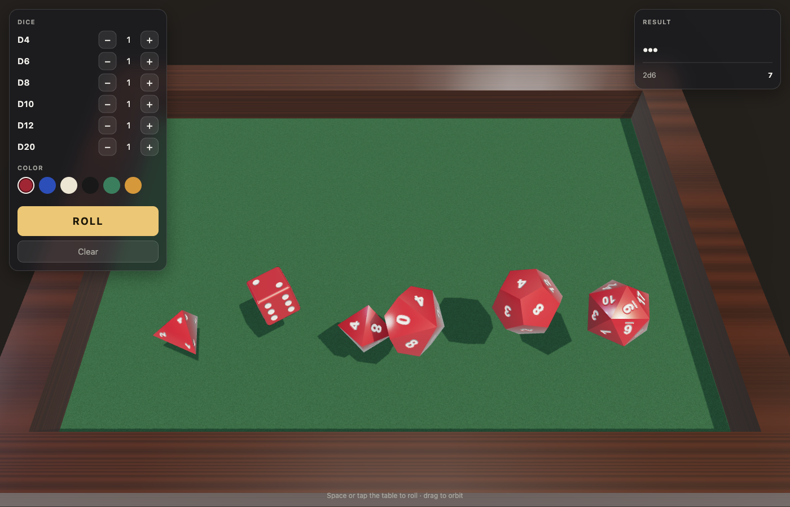

# Resin Dice Roller

3D dice in the browser: d4, d6, d8, d10, d12 and d20 rolled with real physics on a felt table.

**Play:** https://tidymaze.github.io/3d-dice/



## Features

- Pick any mix of dice (up to 10 of each) and a modifier, the panel shows the min to max range.
- Tap a die to hold it, then roll the others (Yahtzee style).
- A die that lands cocked against a wall or another die gets a small hop, like at a real table.
- Impact sounds are generated in the browser, with a mute switch.
- Your dice set, color and modifier are remembered in this browser.
- Space or a tap on the table rolls, drag orbits the camera.
- Phone friendly: the table turns to portrait, and the corner button (or H) hides the panels to leave only the total.

## Stack

Plain ES modules, no build step: [three.js](https://threejs.org) 0.170 for rendering, [cannon-es](https://github.com/pmndrs/cannon-es) 0.20 for physics, both from jsDelivr.

## Run locally

```sh
python3 -m http.server 8765
```

Then open http://localhost:8765/. `selfCheck()` in `dice.js` asserts that every face of every die reads its own value.
